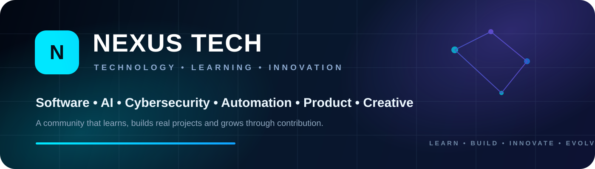

<div align="center">
  
</div>

<br/>

<div align="center">
  <a href="https://git.io/typing-svg">
    
  </a>
</div>

<div align="center">
  <a href="https://github.com/Nexus-tech-01"></a>
  <a href="https://t.me/thenexusorigin"></a>
  <a href="https://chat.whatsapp.com/K6w03Xrne1G6U2eOVtKDqk"></a>
</div>

---

## 🌐 About Nexus Tech

```yaml
organization: Nexus Tech
focus:
  - Software Development
  - Artificial Intelligence
  - Cybersecurity
  - Bots & Automation
  - Cloud & Infrastructure
  - Data & Databases
  - UI/UX & Product Design
  - Research & Innovation
mission: Turn curiosity into skill, skill into contribution, and contribution into real products.
principle: Learn by doing. Build with discipline. Grow through merit.
```

**Nexus Tech** is a technology organization and community built around learning, collaboration and the creation of useful digital products. We bring together beginners, contributors, developers, specialists and project leaders around structured teams and practical work.

---

## 🧪 Our Labs

<table>
<tr>
<td width="50%" valign="top">

### 💻 Software Lab
Web, mobile, backend, APIs, databases, bots, cloud and software architecture.

</td>
<td width="50%" valign="top">

### 🤖 AI Lab
Machine learning, LLMs, agents, RAG, evaluation, AI integration and AI safety.

</td>
</tr>
<tr>
<td width="50%" valign="top">

### 🛡️ Cybersecurity Lab
Application and network security, CTFs, defensive security, authorized testing and research.

</td>
<td width="50%" valign="top">

### 🎨 Creative Studio
UI/UX, product design, visual identity, motion and digital content.

</td>
</tr>
</table>

---

## 🚀 Ecosystem & Projects

<table>
<tr>
<td width="50%" valign="top">

### 🧠 NexCode
Interactive and gamified platform for learning programming, practicing skills and building real projects.

</td>
<td width="50%" valign="top">

### 🌌 The Big Dipper
Messaging and automation ecosystem focused on powerful community tools, bots, commands and interactive experiences.

</td>
</tr>
<tr>
<td width="50%" valign="top">

### 🤝 KnowMe
Social platform centered on challenges, games, interactions and experiences that help people know each other better.

</td>
<td width="50%" valign="top">

### ✨ Nexus AI
Research and product work around assistants, agents, intelligent automation and AI-powered experiences.

</td>
</tr>
</table>

---

## 🛠️ Technologies We Work With

<div align="center">


</div>

---

## 🤝 How We Collaborate

We organize development around **repositories, branches, issues and Pull Requests** so several members can work on the same project without overwriting each other.

```text
main
 ├── feature/...
 ├── fix/...
 ├── design/...
 └── docs/...
        ↓
   Pull Request
        ↓
     Review
        ↓
      Merge
```

Important changes should be reviewed before they reach the main branch. Project access is assigned according to the responsibilities of each member and team.

---

## 🧭 What We Value

<div align="center">


</div>

---

## 📬 Join or Follow Nexus Tech

<div align="center">
  <a href="https://t.me/thenexusorigin"></a>
  <a href="https://chat.whatsapp.com/K6w03Xrne1G6U2eOVtKDqk"></a>
</div>

<div align="center">
  <h3>⚡ We are not building a crowd. We are building an organization.</h3>
  <sub>Nexus Tech • Learn • Build • Innovate • Evolve</sub>
</div>
